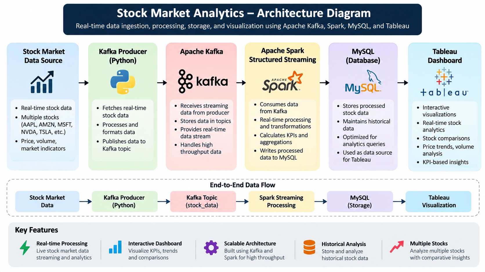

# 📈 Stock Market Analytics Dashboard

An end-to-end stock market analytics pipeline that uses **Python, Apache Kafka, Apache Spark, MySQL, and Tableau** to process, store, and visualize stock market data.

The project provides real-time data ingestion and stream processing along with an interactive Tableau dashboard for stock-level analysis, KPI monitoring, price trends, trading-volume analysis, and multi-stock comparison.

---

## 📊 Dashboard Preview


---

## 🏗️ Project Architecture



---

## 🚀 Project Overview

The Stock Market Analytics project processes stock market data through an end-to-end data pipeline.

The pipeline consists of:

1. **Python Kafka Producer** – Generates and publishes stock market data.
2. **Apache Kafka** – Handles real-time streaming of stock data.
3. **Apache Spark Structured Streaming** – Consumes, processes, and transforms streaming data.
4. **MySQL** – Stores the processed stock market data.
5. **Tableau** – Connects to MySQL and provides interactive analytics and visualization.

The dashboard focuses on five stocks:

- AAPL
- AMZN
- MSFT
- NVDA
- TSLA

It provides a consolidated view of stock prices, percentage changes, trading volume, price ranges, intraday movements, and price trends over time.

---

## ✨ Key Features

- 📡 **Real-Time Data Streaming** – Ingests stock market data through Kafka.
- ⚡ **Spark Stream Processing** – Processes and transforms streaming data using Apache Spark Structured Streaming.
- 🗄️ **MySQL Data Storage** – Stores processed stock data for querying and historical analysis.
- 📊 **Interactive Tableau Dashboard** – Provides KPI cards, stock comparisons, price trends, trading volume analysis, and interactive filtering.
- 📈 **Multi-Stock Analysis** – Supports AAPL, AMZN, MSFT, NVDA, and TSLA.
- 🔄 **End-to-End Data Pipeline** – Connects data ingestion, streaming, processing, storage, and visualization.
- 📉 **Market Analytics** – Analyzes price changes, intraday changes, trading volume, price ranges, and stock price trends.

---

## 🎯 Objectives

The main objectives of this project are:

- Analyze stock price movements
- Compare performance across multiple stocks
- Identify the highest-priced stock
- Identify the top gainer
- Analyze trading volume
- Compare price ranges
- Monitor intraday percentage changes
- Visualize stock price trends over time
- Process streaming stock market data
- Store processed data for analysis
- Provide an interactive dashboard for stock-level analysis

---

## 🛠️ Technology Stack

| Technology | Purpose |
|---|---|
| Python | Data generation and Kafka producer |
| Apache Kafka | Real-time message streaming |
| Apache Spark | Stream processing and transformations |
| MySQL | Data storage and querying |
| Tableau | Data visualization and dashboard development |
| SQL | Data querying and preparation |
| Git & GitHub | Version control and project hosting |

---

## 🗄️ Data Source

The processed stock market data is stored in a MySQL database.

**Database:** `stock_market`

**Table:** `stock_stream`

**Connection:**

```text
MySQL
localhost:3306
Database: stock_market
Table: stock_stream