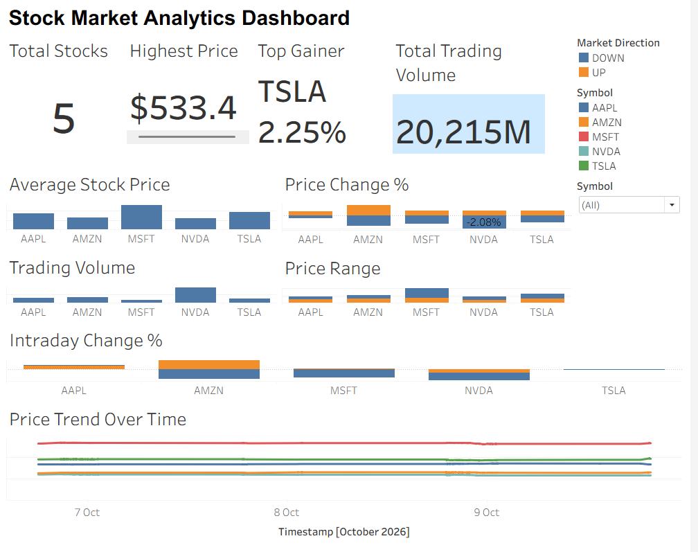

# 📈 Stock Market Analytics Dashboard

An interactive Tableau dashboard for analyzing stock market data stored in MySQL. The dashboard provides KPI-based market summaries, stock-level comparisons, price analysis, trading-volume analysis, and interactive filtering/highlighting across multiple stocks.

## 📊 Dashboard Preview



---

## 🚀 Project Overview

The Stock Market Analytics Dashboard transforms stock market data stored in a MySQL database into an interactive Tableau visualization.

The dashboard focuses on five stocks:

- AAPL
- AMZN
- MSFT
- NVDA
- TSLA

It provides a consolidated view of stock prices, percentage changes, trading volume, price ranges, intraday movements, and price trends over time.

The dashboard also includes interactive stock selection and highlighting so users can easily compare individual stocks.

---

## 🎯 Objectives

The main objectives of this project are:

- Analyze stock price movements
- Compare performance across multiple stocks
- Identify the highest-priced stock
- Identify the top gainer
- Analyze trading volume
- Compare price ranges
- Monitor intraday percentage changes
- Visualize stock price trends over time
- Provide an interactive dashboard for stock-level analysis

---

## 🛠️ Technologies Used

| Technology | Purpose |
|---|---|
| MySQL | Data storage |
| Tableau | Data visualization and dashboard development |
| SQL | Data querying and preparation |
| Tableau Calculations | KPI and analytical calculations |

---

## 🗄️ Data Source

The Tableau workbook is connected to a MySQL database.

**Database:** `stock_market`

**Table:** `stock_stream`

**Connection:**

```text
MySQL
localhost:3306
Database: stock_market
Table: stock_stream